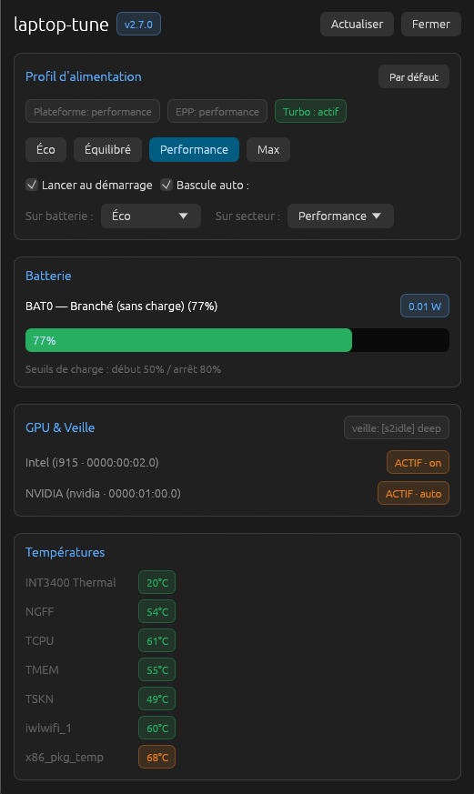
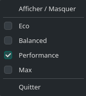

# laptop-tune

**English** | [Français](docs/README.fr.md) | [Español](docs/README.es.md) | [Deutsch](docs/README.de.md) | [中文](docs/README.zh.md) | [日本語](docs/README.ja.md)

Rust CLI, native desktop GUI, and event-driven daemon for auditing and tuning Linux laptops: hybrid GPU runtime power management (Intel / AMD / NVIDIA), CPU power profiles, PCIe ASPM, sleep states, thermals, and battery charge thresholds.

<p align="center">
  
  &nbsp;&nbsp;&nbsp;
  
</p>

## Features

- **`laptop-tune status`**: Live readout of battery draw (`W`) and charge thresholds, PCI GPUs (`driver`, `runtime_status`, D3 `suspended` check), `mem_sleep`, active CPU profile (`platform_profile`, `EPP`, `turbo`), and thermal zones.
- **`laptop-tune gui [--tray]`**: Native `egui` desktop dashboard (follows system light/dark theme and 14 system locales) with live monitoring, one-click profile switching, zero-polling system tray icon, autostart on login, and automatic Battery/AC switching.
- **`laptop-tune profile <eco|balanced|performance|max> [--dry-run]`**: Applies universal kernel `sysfs` profiles (Intel `intel_pstate`/EPP, AMD `amd-pstate`/`cpufreq/boost`, and generic `scaling_governor` fallbacks).
- **`laptop-tune reset [--dry-run]`**: Restores safe default (`balanced`) kernel settings.
- **`laptop-tune thresholds <start> <stop>`**: Sets battery start/stop charge thresholds (e.g. `50 80` or `0 100`).
- **`laptop-tune daemon [--once]`**: Event-driven daemon (`udevadm monitor`, zero polling) for automatic AC/Battery profile switching, GPU runtime PM, and battery thresholds.
- **`laptop-tune generate-rules`**: Detects GPUs and `BAT*` devices to generate `udev` runtime PM rules and `tlp.d` configs.

## Designed for Both Single-GPU & Hybrid Dual-GPU Laptops

- **All Linux Laptops (Intel / AMD iGPU-only):** Full support for CPU `energy_performance_preference` (EPP), `scaling_governor`, Turbo Boost (`intel_pstate` / `cpufreq/boost`), ACPI `platform_profile`, PCIe ASPM, sleep states, thermal sensors, and battery charge thresholds (`50%–80%`).
- **Built Especially for Hybrid Dual-GPU Laptops (NVIDIA Optimus / AMD PRIME):** On dual-GPU laptops, a single rogue process probing Vulkan or holding `/dev/nvidia0` keeps the dedicated GPU awake in `ACTIVE` state, adding **8–15 W** of idle power draw and cutting battery life in half. `laptop-tune` is specifically engineered to keep the dGPU in **`D3cold` (`SUSPENDED · auto`)** at all times unless you explicitly launch a workload on it.

## How It Prevents Random dGPU Wakeups & Coexists with TLP

1. **Dedicated GPU kept in `D3 suspended`**:
   - `install.sh` automatically generates and installs `/etc/udev/rules.d/90-laptop-tune-gpu.rules`, setting `power/control="auto"` on discrete GPUs (NVIDIA / AMD) and creating a stable `/dev/dri/intel-igpu` (or `amd-igpu`) symlink so the desktop compositor stays on the integrated GPU.
   - `laptop-tune gui` uses the lightweight OpenGL (`glow`) renderer on the integrated GPU instead of Vulkan (`wgpu`), so opening the dashboard **never wakes up the NVIDIA/AMD dGPU**.
2. **Using the Dedicated GPU On-Demand (`prime-run` / Games / 3D / CUDA)**:
   - Because the desktop runs entirely on the iGPU, your dGPU stays `SUSPENDED` (`0 W`) during normal use. When a game or heavy workload needs the dedicated GPU, offload it on-demand — the dGPU wakes up for that process and automatically returns to `SUSPENDED` as soon as it closes:
     - **CLI / App (NVIDIA):** `prime-run <app>` *(or `__NV_PRIME_RENDER_OFFLOAD=1 __GLX_VENDOR_LIBRARY_NAME=nvidia __VK_LAYER_NV_optimus=NVIDIA_only <app>`)*
     - **CLI / App (AMD dGPU):** `DRI_PRIME=1 <app>`
     - **Steam (Game Properties → Launch Options):** `prime-run %command%`
     - **Lutris / Heroic Launcher:** Enable **NVIDIA Prime Render Offload** / **Use Dedicated GPU** in the global or per-game settings.
     - **KDE Plasma / GNOME App Launcher:** Right-click any application → *Edit Application* (or properties) → check **Run using dedicated graphics card**.
     - **CUDA / PyTorch / Blender:** Accessing CUDA or OptiX wakes the NVIDIA GPU automatically for the computation and releases it back to `D3 suspended` when finished.
3. **Conflict-free TLP coexistence (or standalone replacement)**:
   - If **TLP** is installed (`/etc/tlp.d`), `install.sh` installs [`99-laptop-tune-override.conf`](packaging/99-laptop-tune-override.conf) so TLP continues managing disks, USB, audio, radio, and battery thresholds while leaving CPU, platform profile, turbo, and PCIe ASPM to `laptop-tune` without race conditions or jumps.
   - On distros **without TLP**, `laptop-tune` handles AC/Battery switching directly via the tray (`Auto-switch`) or `laptop-tune.service`.
4. **Battery Bypass (`Plugged in (not charging)` between thresholds)**:
   - When charge thresholds are active (e.g. `start 50% / stop 80%`) and the battery is between 50% and 80% (or has reached 80%), the kernel reports `Not charging` (`Plugged in (not charging)` at `~0.00 W`). The laptop runs directly off AC wall power without micro-cycling the battery, preserving long-term battery health.
5. **Passwordless profile switching**:
   - Installs [`org.laptop-tune.policy`](packaging/org.laptop-tune.policy) (`<allow_active>yes</allow_active>`), allowing active local desktop sessions to switch power modes in one click without password prompts.

## Power Modes

| Mode | ACPI `platform_profile` | CPU (`EPP` / `governor`) | Turbo Boost | PCIe ASPM | Best for |
| :--- | :--- | :--- | :--- | :--- | :--- |
| **`eco`** | `quiet` *(fallback: `low-power`, `cool`)* | `power` *(or `powersave`)* | Off | `powersupersave` | Maximum battery life & silent fans |
| **`balanced`** / **`reset`** | `balanced` | `balance_performance` *(or `schedutil`)* | On | `default` | Everyday use & safe default |
| **`performance`** | `performance` | `performance` | On | `default` | Compilation, rendering & heavy CPU loads |
| **`max`** | `performance` | `performance` | On | `performance` | Zero PCIe sleep latency (gaming, CUDA/AI, audio, heavy I/O) |

## Installation

### Universal (`install.sh`)

```bash
git clone https://github.com/HmFlashy/laptop-tune.git
cd laptop-tune
./install.sh
```

Uninstall with `./install.sh --uninstall`.

### Arch Linux / Manjaro

Using the included [`packaging/arch/PKGBUILD`](packaging/arch/PKGBUILD):

```bash
cd packaging/arch
makepkg -si
```

### Ubuntu / Debian (`.deb`)

Download the `.deb` from [GitHub Releases](https://github.com/HmFlashy/laptop-tune/releases) or build it locally with [`packaging/deb/build-deb.sh`](packaging/deb/build-deb.sh):

```bash
./packaging/deb/build-deb.sh
sudo apt install ./target/deb/laptop-tune_*.deb
```

## Usage

```bash
laptop-tune status
laptop-tune gui --tray
laptop-tune profile eco --dry-run
sudo laptop-tune profile eco
sudo laptop-tune reset
sudo laptop-tune thresholds 50 80
laptop-tune generate-rules
```

## License

[MIT](LICENSE)
