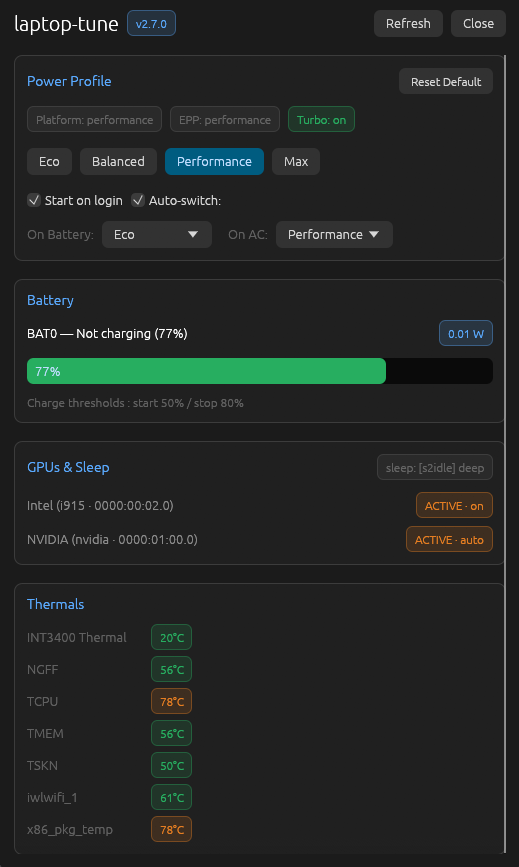
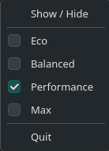

# laptop-tune

[English](../README.md) | [Français](README.fr.md) | **Español** | [Deutsch](README.de.md) | [中文](README.zh.md) | [日本語](README.ja.md)

CLI, interfaz gráfica nativa y demonio basado en eventos en Rust para auditar y optimizar portátiles en Linux: gestión de energía de GPU híbridas (Intel / AMD / NVIDIA), perfiles de CPU, PCIe ASPM, estados de suspensión, temperaturas y umbrales de carga de batería.

<p align="center">
  
  &nbsp;&nbsp;&nbsp;
  
</p>

## Características

- **`laptop-tune status`**: Lectura en vivo del consumo de batería (`W`), umbrales de carga, GPUs PCI (`D3 suspended`), `mem_sleep`, perfil activo y zonas térmicas.
- **`laptop-tune gui [--tray]`**: Panel nativo `egui` (adapta el tema claro/oscuro y 14 idiomas del sistema) con monitoreo en vivo, cambio de perfil en un clic, icono en la bandeja del sistema sin polling y cambio automático Batería / Corriente.
- **`laptop-tune profile <eco|balanced|performance|max> [--dry-run]`**: Aplica perfiles universales del kernel `/sys` (Intel, AMD y gobernadores genéricos).
- **`laptop-tune reset [--dry-run]`**: Restaura los valores seguros predeterminados (`balanced`).
- **`laptop-tune thresholds <inicio> <fin>`**: Configura los umbrales de carga de la batería (ej. `50 80`).
- **`laptop-tune daemon [--once]`**: Demonio basado en eventos (`udevadm monitor`, cero polling).

## Diseñado para todos los portátiles y especializado en Dual-GPU (Optimus / PRIME)

- **Todos los portátiles Linux (iGPU Intel / AMD)**: Soporte completo para perfiles de CPU (`EPP` / `scaling_governor`), Turbo Boost, `platform_profile` ACPI, PCIe ASPM, temperaturas y umbrales de carga de batería (`50 % – 80 %`).
- **Especialmente diseñado para portátiles Dual-GPU híbridos (NVIDIA Optimus / AMD PRIME)**: Mantiene la GPU dedicada en suspensión profunda **`D3cold` (`SUSPENDED · auto`)** mediante reglas `udev` (`/etc/udev/rules.d/90-laptop-tune-gpu.rules`) y usa el motor OpenGL (`glow`) en la iGPU para que la interfaz nunca despierte la GPU dedicada.
- **Uso de la GPU dedicada bajo demanda (`prime-run` / Juegos / CUDA)**:
  - **CLI (NVIDIA)**: `prime-run <app>`
  - **CLI (AMD dGPU)**: `DRI_PRIME=1 <app>`
  - **Steam (Opciones de lanzamiento)**: `prime-run %command%`
  - **Lutris / Heroic / KDE / GNOME**: Activar *Usar tarjeta gráfica dedicada* (*NVIDIA Prime Render Offload*).
- **Coexistencia limpia con TLP**: Si TLP está instalado, `install.sh` instala [`99-laptop-tune-override.conf`](../packaging/99-laptop-tune-override.conf) para evitar cualquier conflicto de CPU o plataforma.
- **Bypass de batería (`Conectado (sin cargar)` entre umbrales)**: Cuando la batería está entre los umbrales (ej. `50 % – 80 %`), el equipo funciona directamente con corriente alterna (`~0.00 W`) sin degradar la batería.

## Modos de energía

| Modo | ACPI `platform_profile` | CPU (`EPP` / `governor`) | Turbo Boost | PCIe ASPM | Ideal para |
| :--- | :--- | :--- | :--- | :--- | :--- |
| **`eco`** | `quiet` | `power` | Apagado | `powersupersave` | Máxima autonomía y silencio |
| **`balanced`** / **`reset`** | `balanced` | `balance_performance` | Encendido | `default` | Uso diario equilibrado |
| **`performance`** | `performance` | `performance` | Encendido | `default` | Compilación y cargas pesadas de CPU |
| **`max`** | `performance` | `performance` | Encendido | `performance` | Cero latencia PCIe (juegos, IA/CUDA, audio) |

## Instalación

```bash
git clone https://github.com/HmFlashy/laptop-tune.git
cd laptop-tune
./install.sh
```

## Licencia

[MIT](../LICENSE)
