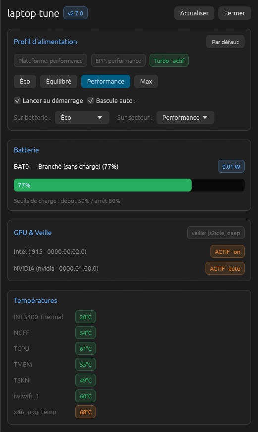
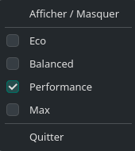

# laptop-tune

[English](../README.md) | **Français** | [Español](README.es.md) | [Deutsch](README.de.md) | [中文](README.zh.md) | [日本語](README.ja.md)

CLI, interface graphique native et démon événementiel en Rust pour auditer et optimiser les PC portables sous Linux : gestion d'énergie des GPU hybrides (Intel / AMD / NVIDIA), profils CPU, PCIe ASPM, états de veille, températures et seuils de charge batterie.

<p align="center">
  
  &nbsp;&nbsp;&nbsp;
  
</p>

## Fonctionnalités

- **`laptop-tune status`** : lecture en direct de la consommation batterie (`W`) et des seuils de charge, des GPU PCI (`driver`, `runtime_status`, veille `D3 suspended`), de `mem_sleep`, du profil CPU actif et des sondes thermiques.
- **`laptop-tune gui [--tray]`** : tableau de bord natif `egui` (suit le thème clair/sombre et la langue du système parmi 14 langues) avec suivi en direct, changement de profil en 1 clic, icône dans la barre des tâches sans polling, lancement au démarrage et bascule auto Batterie / Secteur.
- **`laptop-tune profile <eco|balanced|performance|max> [--dry-run]`** : applique les profils universels via `/sys` (Intel `intel_pstate`/EPP, AMD `amd-pstate`/`cpufreq/boost`, et repli `scaling_governor`).
- **`laptop-tune reset [--dry-run]`** : restaure les valeurs par défaut (`balanced`).
- **`laptop-tune thresholds <début> <arrêt>`** : définit les seuils de charge batterie (ex. `50 80` ou `0 100`).
- **`laptop-tune daemon [--once]`** : démon événementiel (`udevadm monitor`, zéro polling) pour la bascule AC/Batterie, le runtime PM des GPU et les seuils batterie.
- **`laptop-tune generate-rules`** : détecte le matériel et génère les règles `udev` et `tlp.d`.

## Conçu pour tous les PC portables & spécialisé Dual-GPU (Optimus / PRIME)

- **Tous les PC portables Linux (iGPU seul Intel ou AMD)** : gestion complète des profils CPU (`EPP` / `scaling_governor`), du Turbo Boost (`intel_pstate` / `cpufreq/boost`), du `platform_profile` ACPI, du PCIe ASPM, de la veille, des températures et des seuils de charge batterie (`50 % – 80 %`).
- **Pensé spécialement pour les PC portables Dual-GPU (Intel/AMD + NVIDIA/AMD dédié)** : sur les portables hybrides, une simple application qui sonde Vulkan au démarrage suffit à réveiller la carte NVIDIA en état `ACTIVE`, ajoutant **8 à 15 W** de consommation inutile au repos (autonomie divisée par deux). `laptop-tune` est conçu pour maintenir le GPU dédié en sommeil profond **`D3cold` (`SUSPENDED · auto`)** en permanence, sauf quand vous lancez explicitement un jeu ou un calcul dessus.

## Veille D3 du GPU dédié, `prime-run` & Coexistence avec TLP

1. **GPU dédié maintenu en veille `D3 suspended` (aucun réveil aléatoire)** :
   - `install.sh` génère et installe automatiquement `/etc/udev/rules.d/90-laptop-tune-gpu.rules` pour forcer `power/control="auto"` sur le GPU dédié (NVIDIA / AMD) et créer le lien `/dev/dri/intel-igpu` (ou `amd-igpu`) afin que le bureau reste sur l'iGPU.
   - L'interface `laptop-tune gui` utilise le moteur OpenGL léger (`glow`) sur l'iGPU plutôt que Vulkan (`wgpu`), ce qui garantit que **l'ouverture de la fenêtre ne réveille jamais la carte NVIDIA/AMD**.
2. **Utiliser le GPU dédié à la demande (`prime-run`, Jeux, 3D, CUDA)** :
   - Le bureau et le navigateur tournent à 100 % sur l'iGPU (carte dédiée `SUSPENDED` à `0 W`). Pour lancer un jeu ou une application gourmande sur la carte dédiée, activez-la à la demande — elle se réveillera uniquement pour ce programme et retombera automatiquement en `SUSPENDED` dès sa fermeture :
     - **En ligne de commande (NVIDIA)** : `prime-run <application>` *(ou `__NV_PRIME_RENDER_OFFLOAD=1 __GLX_VENDOR_LIBRARY_NAME=nvidia __VK_LAYER_NV_optimus=NVIDIA_only <application>`)*
     - **En ligne de commande (AMD dédié)** : `DRI_PRIME=1 <application>`
     - **Steam (Propriétés du jeu → Options de lancement)** : `prime-run %command%`
     - **Lutris / Heroic Games Launcher** : activez l'option **NVIDIA Prime Render Offload** / **Utiliser le GPU dédié** dans les paramètres globaux ou du jeu.
     - **Menu KDE Plasma / GNOME (par application)** : clic droit sur l'icône d'une application → *Modifier l'application* → cochez **Lancer avec la carte graphique dédiée**.
     - **CUDA / PyTorch / Blender** : l'accès à CUDA/OptiX réveille automatiquement la carte NVIDIA pendant le calcul puis la remet en `SUSPENDED` dès la fin du script.
3. **Coexistence propre avec TLP (ou remplacement complet)** :
   - Si **TLP** est présent (`/etc/tlp.d`), `install.sh` installe [`99-laptop-tune-override.conf`](../packaging/99-laptop-tune-override.conf) : TLP continue de gérer disques, USB, audio, radio et seuils batterie, mais laisse le CPU, le profil ACPI, le Turbo et le PCIe ASPM à `laptop-tune` (zéro conflit, zéro micro-saut).
   - Sur les distributions **sans TLP**, `laptop-tune` gère directement la bascule Batterie/Secteur via le tray (`Bascule auto`) ou le service `laptop-tune.service`.
4. **Protection batterie (`Branché (sans charge)` entre les seuils)** :
   - Lorsque les seuils de charge sont actifs (ex. `début 50 % / arrêt 80 %`) et que la batterie se trouve entre 50 % et 80 % (ou a atteint 80 %), le noyau affiche `Not charging` (`Branché (sans charge)` à `~0.00 W`). Le PC est alors alimenté directement par le secteur sans charger ni décharger la batterie, ce qui évite les micro-cycles et préserve sa durée de vie.
5. **Changement de mode sans mot de passe** :
   - Installe la policy Polkit [`org.laptop-tune.policy`](../packaging/org.laptop-tune.policy) (`<allow_active>yes</allow_active>`) permettant à la session locale active de changer de profil en 1 clic sans popup `sudo`.

## Modes d'alimentation

| Mode | ACPI `platform_profile` | CPU (`EPP` / `governor`) | Turbo Boost | PCIe ASPM | Idéal pour |
| :--- | :--- | :--- | :--- | :--- | :--- |
| **`eco`** | `quiet` *(repli : `low-power`, `cool`)* | `power` *(ou `powersave`)* | Inactif | `powersupersave` | Autonomie maximale et silence |
| **`balanced`** / **`reset`** | `balanced` | `balance_performance` *(ou `schedutil`)* | Actif | `default` | Usage quotidien équilibré |
| **`performance`** | `performance` | `performance` | Actif | `default` | Compilation, rendu et charges CPU lourdes |
| **`max`** | `performance` | `performance` | Actif | `performance` | Latence PCIe nulle (jeux, CUDA/IA, audio, E/S intensives) |

## Installation

### Universelle (`install.sh`)

```bash
git clone https://github.com/HmFlashy/laptop-tune.git
cd laptop-tune
./install.sh
```

Désinstallation : `./install.sh --uninstall`.

### Arch Linux / Manjaro

```bash
cd packaging/arch
makepkg -si
```

### Ubuntu / Debian (`.deb`)

Téléchargez le `.deb` depuis les [Releases GitHub](https://github.com/HmFlashy/laptop-tune/releases) ou compilez-le localement :

```bash
./packaging/deb/build-deb.sh
sudo apt install ./target/deb/laptop-tune_*.deb
```

## Licence

[MIT](../LICENSE)
