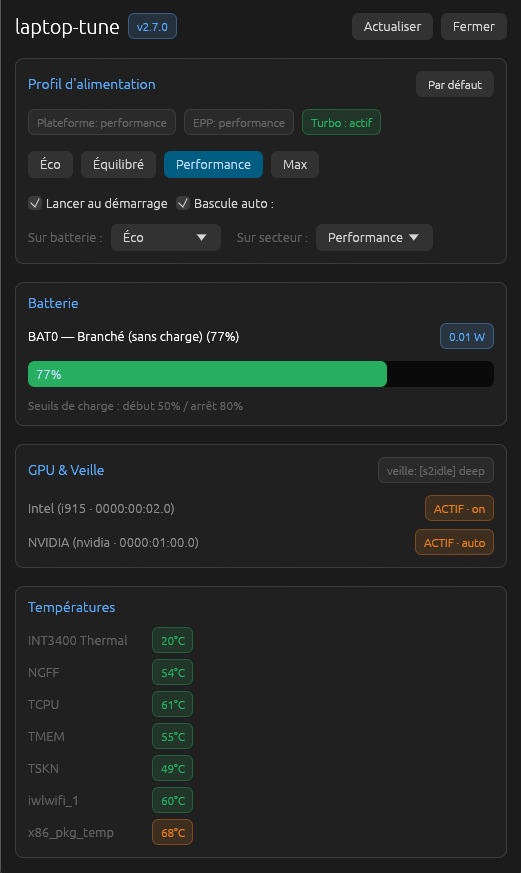
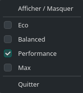

# laptop-tune

[English](../README.md) | [Français](README.fr.md) | [Español](README.es.md) | [Deutsch](README.de.md) | [中文](README.zh.md) | **日本語**

Linux ノート PC 向けの Rust 製 CLI・ネイティブ GUI・イベント駆動デーモン：ハイブリッド GPU のランタイム電源管理（Intel / AMD / NVIDIA）、CPU 電源プロファイル、PCIe ASPM、スリープ状態、温度モニター、バッテリー充電しきい値を一括管理します。

<p align="center">
  
  &nbsp;&nbsp;&nbsp;
  
</p>

## 主な機能

- **`laptop-tune status`**：バッテリー消費電力（`W`）、充電しきい値、PCI GPU の稼働状態（`D3 suspended`）、`mem_sleep`、CPU プロファイル、温度をリアルタイム表示。
- **`laptop-tune gui [--tray]`**：ネイティブ `egui` ダッシュボード（システムのライト/ダークテーマおよび 14 言語に自動対応）。ワンクリックでのモード切替、ポーリングなしのシステムトレイアイコン、ログイン時起動、バッテリー/AC 自動切替に対応。
- **`laptop-tune profile <eco|balanced|performance|max> [--dry-run]`**：Intel / AMD / 汎用 CPU 向けのカーネル `/sys` プロファイルを適用。
- **`laptop-tune reset [--dry-run]`**：安全なデフォルト設定（`balanced`）に復元。
- **`laptop-tune thresholds <開始> <停止>`**：バッテリーの充電開始・停止しきい値を設定（例：`50 80`）。
- **`laptop-tune daemon [--once]`**：`udevadm monitor` によるゼロポーリング・デーモン。

## シングル GPU ＆ ハイブリッド Dual-GPU ノート PC（Optimus / PRIME）両対応

- **すべての Linux ノート PC（Intel / AMD 内蔵 GPU のみ）**：CPU プロファイル（`EPP` / `scaling_governor`）、ターボブースト、ACPI `platform_profile`、PCIe ASPM、温度センサー、バッテリー充電しきい値（`50% – 80%`）を完全にサポート。
- **ハイブリッド Dual-GPU ノート PC 向けに特化（NVIDIA Optimus / AMD PRIME）**：`udev` ルール（`/etc/udev/rules.d/90-laptop-tune-gpu.rules`）により専用 GPU を **`D3cold` スリープ（`SUSPENDED · auto`）** に維持し、GUI も内蔵 GPU 上の OpenGL（`glow`）で描画するため、**ダッシュボードを開いても NVIDIA/AMD GPU を一切起動しません**。
- **必要な時だけ専用 GPU を使用（`prime-run` / ゲーム / CUDA）**：
  - **CLI (NVIDIA)**：`prime-run <アプリ>`
  - **CLI (AMD dGPU)**：`DRI_PRIME=1 <アプリ>`
  - **Steam 起動オプション**：`prime-run %command%`
  - **Lutris / Heroic / KDE / GNOME**：*専用グラフィックカードで実行（Prime Render Offload）* を有効化。
- **TLP との競合ゼロ共存**：TLP 環境では [`99-laptop-tune-override.conf`](../packaging/99-laptop-tune-override.conf) を自動配置し、CPU プロファイルの競合を防止します。
- **バッテリーバイパス保護（`電源接続 (充電なし)`）**：充電しきい値の間（例：`50% – 80%`）では AC 電源から直接給電（`~0.00 W`）し、バッテリーの劣化を防ぎます。

## 電源モード

| モード | ACPI `platform_profile` | CPU (`EPP` / `governor`) | ターボブースト | PCIe ASPM | 用途 |
| :--- | :--- | :--- | :--- | :--- | :--- |
| **`eco`** | `quiet` | `power` | OFF | `powersupersave` | バッテリー持続時間重視・静音 |
| **`balanced`** / **`reset`** | `balanced` | `balance_performance` | ON | `default` | 日常利用・標準設定 |
| **`performance`** | `performance` | `performance` | ON | `default` | ビルド・レンダリング・高負荷処理 |
| **`max`** | `performance` | `performance` | ON | `performance` | PCIe スリープ遅延ゼロ（ゲーム、CUDA/AI、オーディオ） |

## インストール

```bash
git clone https://github.com/HmFlashy/laptop-tune.git
cd laptop-tune
./install.sh
```

## ライセンス

[MIT](../LICENSE)
