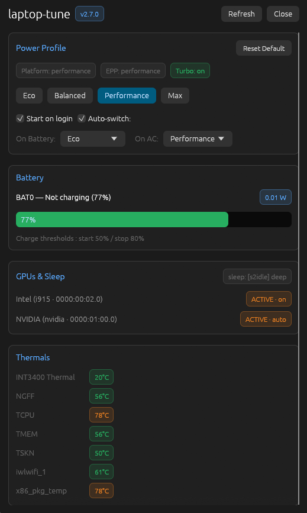
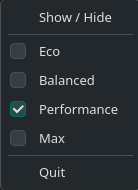

# laptop-tune

[English](../README.md) | [Français](README.fr.md) | [Español](README.es.md) | [Deutsch](README.de.md) | **中文** | [日本語](README.ja.md)

基于 Rust 编写的 Linux 笔记本电源与性能调优工具（含命令行、原生桌面 GUI 与事件驱动守护进程）：支持混合显卡运行时电源管理（Intel / AMD / NVIDIA）、CPU 性能模式、PCIe ASPM、休眠状态、温度监控以及电池充电阈值管理。

<p align="center">
  
  &nbsp;&nbsp;&nbsp;
  
</p>

## 功能特性

- **`laptop-tune status`**：实时查看电池功耗（`W`）、充电阈值、PCI 显卡状态（`D3 suspended` 休眠检测）、`mem_sleep`、当前 CPU 策略与温度传感器。
- **`laptop-tune gui [--tray]`**：原生 `egui` 桌面面板（自动跟随系统浅色/深色主题及 14 种系统语言），支持一键切换模式、零轮询系统托盘图标、开机自启以及电池/电源自动切换。
- **`laptop-tune profile <eco|balanced|performance|max> [--dry-run]`**：应用通用 Linux `/sys` 内核性能配置（兼容 Intel、AMD 及通用调频器）。
- **`laptop-tune reset [--dry-run]`**：恢复安全默认设置（`balanced`）。
- **`laptop-tune thresholds <start> <stop>`**：设置电池起止充电阈值（例如 `50 80`）。
- **`laptop-tune daemon [--once]`**：基于 `udevadm monitor` 的零轮询事件驱动守护进程。

## 兼顾单核显与混合双显卡笔记本（Optimus / PRIME）

- **支持所有 Linux 笔记本（Intel / AMD 单核显）**：完整支持 CPU 性能偏好（`EPP` / `scaling_governor`）、睿频加速（Turbo Boost）、ACPI `platform_profile`、PCIe ASPM、温度传感器与电池充电阈值（`50% – 80%`）。
- **专为混合双显卡笔记本打造（NVIDIA Optimus / AMD PRIME）**：通过 `udev` 规则（`/etc/udev/rules.d/90-laptop-tune-gpu.rules`）将独立显卡保持在 **`D3cold` 深度休眠（`SUSPENDED · auto`）**，且 GUI 面板采用轻量 OpenGL（`glow`）运行在核显上，**绝不会意外唤醒独立显卡**。
- **按需调用独立显卡（`prime-run` / 游戏 / CUDA）**：
  - **命令行 (NVIDIA)**：`prime-run <程序>`
  - **命令行 (AMD 独显)**：`DRI_PRIME=1 <程序>`
  - **Steam 启动选项**：`prime-run %command%`
  - **Lutris / Heroic / KDE / GNOME**：勾选 *使用独立显卡运行 (Prime Render Offload)*。
- **与 TLP 无冲突共存**：若安装了 TLP，`install.sh` 会自动配置 [`99-laptop-tune-override.conf`](../packaging/99-laptop-tune-override.conf)，避免策略冲突。
- **电池旁路保护（`已接通电源（未充电）`）**：当电量处于起止阈值之间（如 `50% – 80%`）时，笔记本直接由外部电源供电（电池功耗 `~0.00 W`），避免频繁微充放电损耗电池寿命。

## 电源模式

| 模式 | ACPI `platform_profile` | CPU (`EPP` / `governor`) | 睿频加速 (Turbo) | PCIe ASPM | 适用场景 |
| :--- | :--- | :--- | :--- | :--- | :--- |
| **`eco`** | `quiet` | `power` | 关闭 | `powersupersave` | 最长续航与静音风扇 |
| **`balanced`** / **`reset`** | `balanced` | `balance_performance` | 开启 | `default` | 日常均衡使用 |
| **`performance`** | `performance` | `performance` | 开启 | `default` | 编译、渲染与高负载计算 |
| **`max`** | `performance` | `performance` | 开启 | `performance` | 零 PCIe 唤醒延迟（游戏、CUDA/AI、低延迟音频） |

## 安装

```bash
git clone https://github.com/HmFlashy/laptop-tune.git
cd laptop-tune
./install.sh
```

## 许可证

[MIT](../LICENSE)
